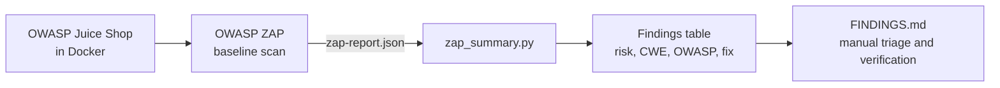

# AppSec DAST Lab


Dynamic application security testing (DAST) of OWASP Juice Shop with OWASP ZAP, plus a Python tool that
turns ZAP's raw output into a prioritised findings table. Every push runs static analysis, tests and a
ZAP baseline scan in GitHub Actions.

> Juice Shop is a deliberately vulnerable application built by OWASP for security training.
> Only scan applications you own or are authorised to test.

## How it works



## Results

ZAP raised **12 alerts**. After manual verification with `curl -I`, I triaged them into
**6 findings to fix** and **5 accepted as not significant**. See [FINDINGS.md](FINDINGS.md).

| Finding | Risk |
|---|---|
| Content Security Policy header not set | Medium |
| Permissive CORS policy (`Access-Control-Allow-Origin: *`) | Medium |
| JavaScript loaded from other domains | Low |
| Dangerous JavaScript functions (needs code review) | Low |
| Cross-origin isolation headers missing | Low |
| Outdated `Feature-Policy` header | Low |

## Run it locally

Requires Docker and Python 3.10+.

```bash
docker network create dastlab
docker run -d --name juice-shop --network dastlab -p 3000:3000 bkimminich/juice-shop:v17.1.1
docker run --rm --network dastlab -v "$PWD:/zap/wrk:rw" zaproxy/zap-stable zap-baseline.py \
  -t http://juice-shop:3000 -J zap-report.json -r zap-report.html -I
python zap_summary.py --input zap-report.json
```

Add `--fail-on-high` to exit with an error when any High risk finding exists, for use as a CI gate.

## CI pipeline

| Job | Steps |
|---|---|
| `code-checks` | ruff (lint), bandit (SAST), pytest (5 tests) |
| `dast-scan` | starts Juice Shop as a service container, runs the ZAP baseline scan, publishes the findings table to the run summary, saves full reports as artefacts |

## What I learned

- **DAST and SAST find different problems:** bandit reads code; ZAP tests the running app from outside.
- **Scanner output is not a report:** verifying, prioritising and explaining findings is the real work.
- **Automated mappings need review:** my CWE-to-OWASP mapping put the CORS issue under A01;
  on review, A05 Security Misconfiguration fits better.
- **A passive scan has limits:** it cannot find injection or access-control flaws that need active testing.

## Next steps

- Run an authenticated scan, so ZAP can test pages behind login
- Run active scans in an isolated lab environment
- Fail the pipeline on High risk findings with `--fail-on-high`

## Project structure

```
.github/workflows/ci.yml   # CI: SAST, tests, DAST
zap_summary.py             # turns ZAP JSON into a prioritised findings table
samples/                   # small sample report used by the tests
tests/                     # pytest tests
FINDINGS.md                # triaged findings report
```